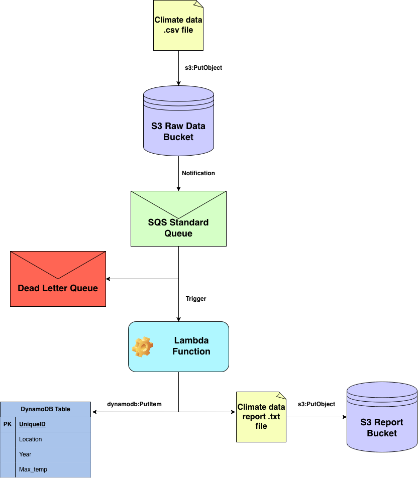

This application uses S3 to store CSV files with NOAA climate data. Updloading files to the bucket triggers an SQS queue that 
operates the Lambda function to process the data in the CSV file
and generate a .txt file report, stored in S3, and metadata,
stored in DynamoDB.

Setup:
1. Create S3 Raw Data and Report buckets
2. Create SQS Standard queue with attached dead letter queue
3. Set S3 Raw Data bucket notification to alert SQS queue upon .csv file creation
4. Create DynamoDB table with string partition key and no sort key
5. Create Lambda function with lambda_function.py code
6. Configure permissions on Lambda function execution role to include:
    a. CloudWatch Logs
    b. S3 Raw Data and Report buckets
    c. SQS message queue
    d. DynamoDB table
7. Create trigger on Lambda linked to SQS queue